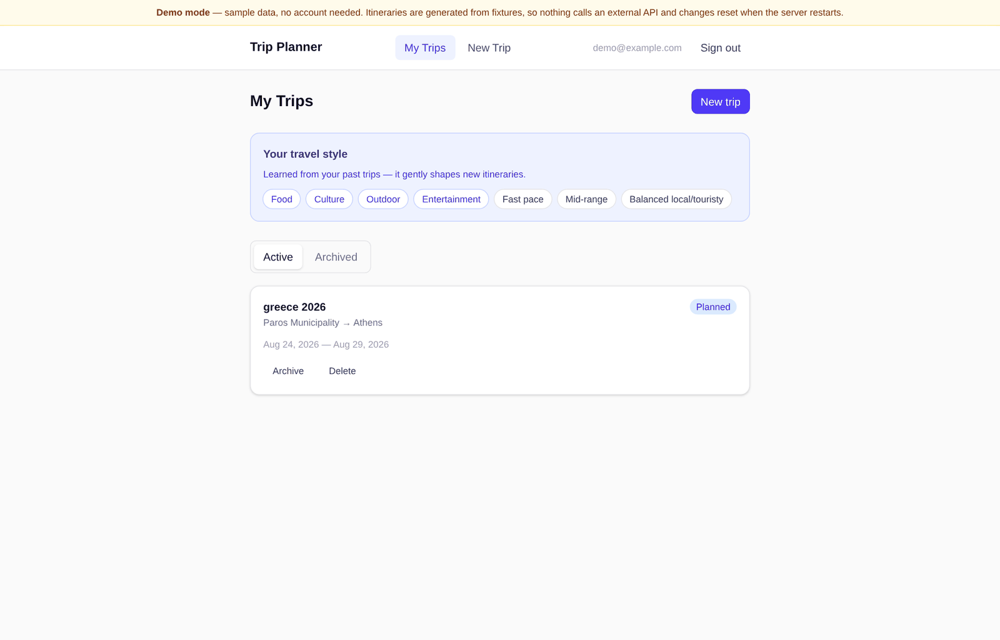
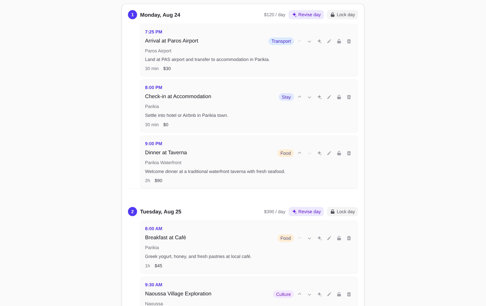
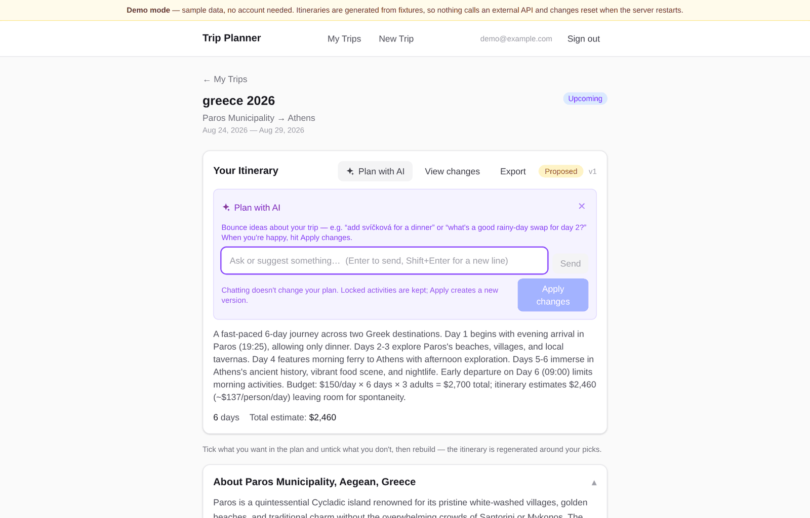

# Trip Planner

An LLM-assisted travel planner: describe a trip, get a day-by-day itinerary you
can revise by talking to it. Multi-city trips, flight and accommodation
constraints, per-city destination guides, and a subscribable calendar feed.

Built with Next.js (App Router), Supabase (Postgres + Auth, RLS-enforced), and
the Anthropic API.

**[Live demo →](https://trip-planner-tan-three.vercel.app)** — no signup, no API keys; runs entirely on fixtures.
The hosted demo uses sample data and never calls an AI API. To try real AI-generated
itineraries, [run it with your own keys](#running-against-real-services) — the
hosted version isn't wired to a paid key on purpose, so nobody's usage is billed
to me.



| Day-by-day plan: times, costs, per-day and per-activity AI revise, lock, reorder | "Plan with AI": discuss changes first, then apply them as a new version |
|---|---|
|  |  |

## How it was built

I built this with Claude Code, working from a milestone plan rather than one big
prompt: a skeleton and foundations first (M0), then auth and the app shell, the
consulting session, itinerary generation, and manual editing (M1), booking-driven
generation (M8), and multi-city trips in five phases. The core single-user product
was working in a day; multi-city and logistics landed about ten days later. Demo
mode came last, once the product was worth showing to people.

**Product decisions along the way**

- **Talk first, change later.** I started with a "revise the whole trip" text box,
  then replaced it with a *Plan with AI* chat that discusses changes and only
  rewrites the plan when you hit Apply. Chatting never changes the itinerary, and
  every apply creates a new version you can review under *View changes*.
- **Locked activities are time anchors.** Revisions at all three granularities
  (whole trip, one day, one activity) keep locked items fixed and rebuild around
  them, so the AI can't undo what the traveller has already decided.
- **Cut what didn't earn its place.** I built a *Tidy up* action and removed it a
  few commits later; manual reorder, move-to-day and drag-and-drop covered the need.
- **Learn from past trips.** Preferences inferred from earlier trips gently bias new
  itineraries and are shown on the dashboard, so the personalisation is visible
  and not hidden in a prompt.
- **A demo that costs nothing.** One flag swaps the LLM, database, auth and
  geocoder for fixtures behind four seams, so the whole product is shareable with
  no keys and no bill (see below).

**What broke, and what I changed**

- Row-level security rejected `INSERT … RETURNING` on trip creation; fixed in the
  policies rather than by loosening them.
- The model was inventing trip dates, so the brief's dates are now derived from the
  trip row, never from the LLM.
- Date-only values showed one day early in negative-UTC timezones, and activity
  order drifted until I added an explicit `sort_order`.

## Where restaurant suggestions come from

Early versions produced generic meals ("Dinner at Taverna") for any city outside a
small curated sample, because the model had nothing local to ground on. Live mode
now pulls **real, named venues from [OpenStreetMap](https://www.openstreetmap.org)**
(via the free Overpass API; no key needed) and merges them with the curated posts
before ranking.

I deliberately did **not** use Google or Tripadvisor ratings: star ratings reward
whatever the most tourists have already visited, which is the opposite of "where
locals actually eat". OpenStreetMap has no ratings, so the app derives a *locality*
score from what the map does know:

- chains (brand tags) are left out entirely
- has its own Wikipedia/Wikidata entry, or is tagged as a visitor attraction → less local
- sits within 150 m of several *named* major sights (the classic tourist-trap zone) → less local
- independent and away from the main sights → local

That score feeds the same ranking as everything else, so the existing
local ↔ touristy slider decides which venues the model sees. The model is told to
name only venues present in that data and never to invent a restaurant; if
nothing fits it says so generically instead.

**Honest limits.** The locality score is a heuristic, not a measurement, and it
will misjudge some places (a genuinely local café on a tourist street, a chain the
map doesn't tag). OpenStreetMap coverage varies by region and carries no ratings,
prices or reviews. Some venues are only named in the local script (for example Greek), so
those names appear untransliterated. The public Overpass service is rate-limited, so
results are cached in memory, each lookup has a 12-second budget (plus a short fallback to a plain place search, which finds fewer venues and cannot tell how close they are to sights), and a failed lookup
falls back to generic suggestions rather than failing the plan. The hosted demo does not use any of this: its itinerary is a saved
sample generated before this feature existed, and its curated posts (Tokyo and
Berlin) are seeded sample data.

Place data © [OpenStreetMap contributors](https://www.openstreetmap.org/copyright)
(ODbL). Set `PLACES_SOURCE=off` to disable the lookup.

Run the unit tests for the venue logic with `npm test`.

## Try it — demo mode

Demo mode runs the whole product with **no API keys, no database, and no
signup**:

```bash
npm install
npm run dev:demo      # http://localhost:3000
```

You land straight in a populated account with a real two-city Greece itinerary
(Paros → Athens) and can click through everything: browse the plan, revise a
day, swap a single activity, chat about the itinerary, generate a new trip.

There is no `.env.local` to create — demo mode is fully self-contained. Every
external dependency is served from fixtures:

| Dependency | Normal mode | Demo mode |
|---|---|---|
| Anthropic API | `AnthropicProvider` | `MockProvider` — synthesises itineraries from the brief |
| Supabase (data) | Postgres via RLS | in-memory store seeded from a real exported trip |
| Supabase (auth) | cookie session | always signed in as a demo user |
| Photon geocoding | live HTTP | local city list |

Demo writes live in memory for the life of the server process and reset on
restart. Nothing is persisted and nothing is billed.

`npm run build:demo` and `npm run start:demo` do the same for a production
build, which is what makes demo mode deployable as a shareable link.

### How the switch works

One flag, `NEXT_PUBLIC_MOCK_MODE=1`, read in `lib/mock/flag.ts` and applied at
four seams:

- `lib/db/queries.ts` picks the real or mock query module at import time, so no
  page, server action, or route handler knows which is live.
- `lib/llm/provider.ts` resolves `defaultProvider` to `MockProvider`.
- `lib/auth/index.ts` returns a fixture user instead of asking Supabase.
- `proxy.ts` skips session refresh and sends `/login` to the dashboard.

Both query modules export the same 38 names, and the dispatcher types the mock
against the real one — if either drifts, the build fails.

## Running against real services

Bring your own keys: a free [Supabase](https://supabase.com) project and an
[Anthropic API key](https://console.anthropic.com). Every generate, revise, chat
and destination-guide call is billed to *your* Anthropic account, so set a spend
limit first.

```bash
cp .env.local.example .env.local   # fill in the values
npm install
npm run dev
```

Required: `NEXT_PUBLIC_SUPABASE_URL`, `NEXT_PUBLIC_SUPABASE_ANON_KEY`,
`SUPABASE_SERVICE_ROLE_KEY`, `ANTHROPIC_API_KEY`, `NEXT_PUBLIC_SITE_URL`.

For a fresh Supabase project, apply `supabase/migrations/` in order
(`0001` … `0007`) plus the `supabase/fix_*.sql` constraints.

> Itinerary generation, revision, chat, and destination guides all bill your
> Anthropic key. Set a spend limit before sharing a non-demo deployment.

See `DEPLOY.md` for deploying to Vercel.
